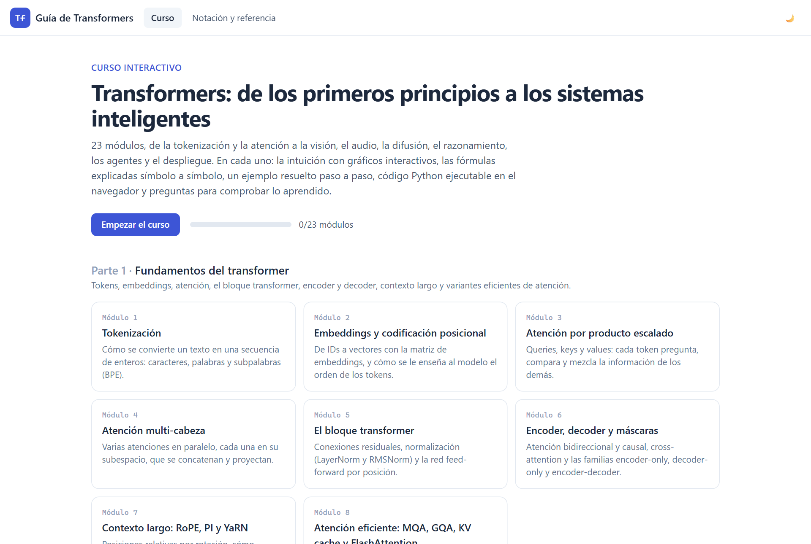
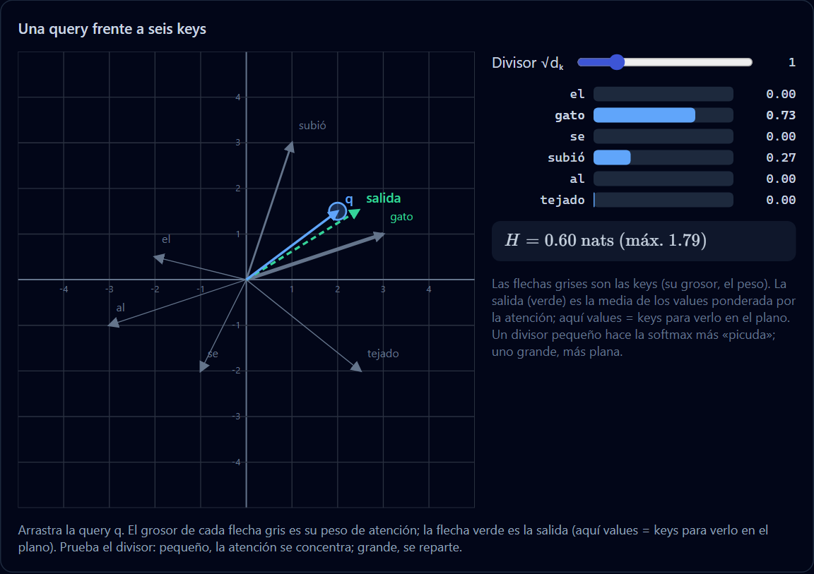
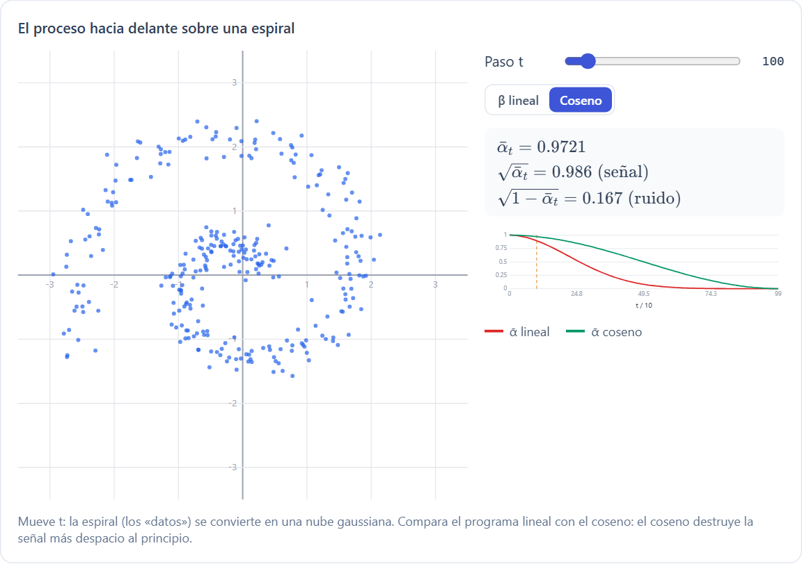
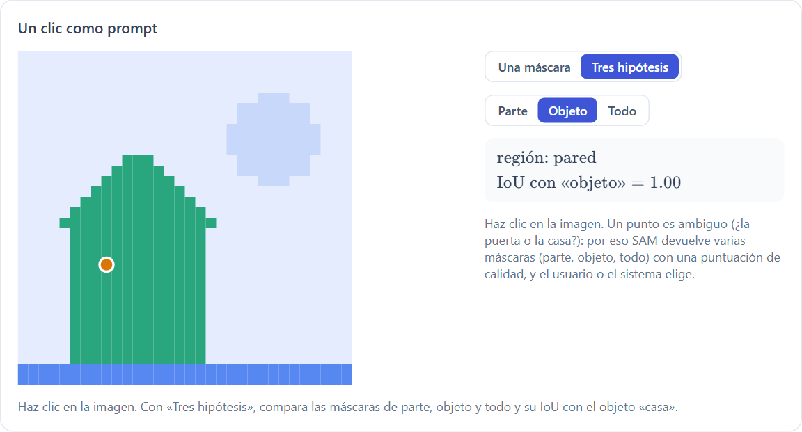
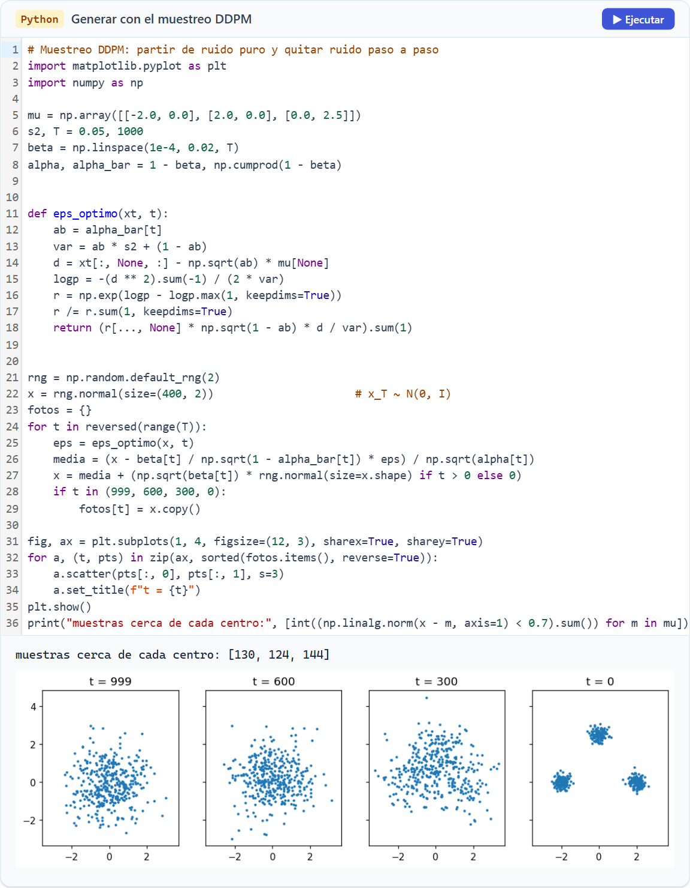
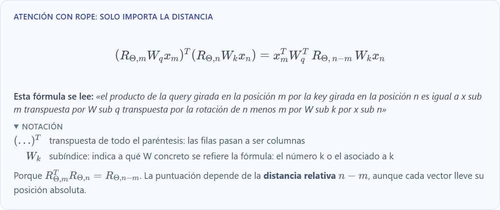

# Guía de Transformers

**Curso interactivo y autocontenido, en español, sobre la arquitectura transformer y sus aplicaciones más allá del texto.** Cada concepto se presenta con su motivación, una intuición apoyada en gráficos manipulables, su formalización matemática, un ejemplo resuelto paso a paso, código Python ejecutable en el propio navegador y preguntas de autoevaluación.

El temario se organiza en **23 módulos** agrupados en cuatro partes: de la tokenización y la atención a las series temporales, la visión, la difusión, el audio, el aprendizaje por refuerzo, el razonamiento, los agentes y el despliegue.



## Contenido

- [Características](#características)
- [Temario](#temario)
- [Inicio rápido](#inicio-rápido)
- [Comandos](#comandos)
- [Notebooks opcionales con modelos reales](#notebooks-opcionales-con-modelos-reales)
- [Pruebas y garantías de calidad](#pruebas-y-garantías-de-calidad)
- [Arquitectura](#arquitectura)
- [Guía para autores](#guía-para-autores)
- [Créditos](#créditos)

## Características

**Una plantilla pedagógica común.** Los 23 módulos tienen las mismas secciones, en este orden:

| Sección | Qué aporta |
| --- | --- |
| ¿Por qué importa? | Motivación con un caso real |
| Intuición | Explicación geométrica apoyada en visualizaciones interactivas |
| Formalización | Definiciones y fórmulas; **cada fórmula indica cómo se lee** y explica sus símbolos |
| Ejemplo resuelto | Cálculo con pasos que se revelan uno a uno |
| Laboratorio Python | Celdas editables y ejecutables en el navegador |
| Comprueba tu comprensión | Preguntas de opción múltiple, numéricas y de matrices, con explicación |
| Conexión con ML y resumen | Aplicación práctica e ideas clave |
| Retos y extensiones | Ejercicios abiertos para profundizar |

**Visualizaciones interactivas.** 38 componentes propios en SVG: fusiones BPE paso a paso, una query arrastrable frente a seis keys, matrices de atención y máscaras, RoPE como rotación, el problema de la aguja en el pajar, la calculadora de la KV cache, la softmax en línea de FlashAttention, parches de PatchTST y cubetas de Chronos, ventanas desplazadas de Swin, un clic de Segment Anything, el proceso de difusión sobre una espiral, la guía sin clasificador, espectrogramas y escala mel, cuantización vectorial residual, Decision Transformer, MCTS, Muon, cuantización con valores atípicos y más.



<table>
  <tr>
    <td width="50%"></td>
    <td width="50%"></td>
  </tr>
  <tr>
    <td align="center"><sub>Difusión: el proceso hacia delante sobre una espiral</sub></td>
    <td align="center"><sub>Segment Anything: un clic y tres hipótesis de máscara</sub></td>
  </tr>
</table>

**Python real en el navegador.** Las celdas se ejecutan con [Pyodide](https://pyodide.org) (CPython compilado a WebAssembly) dentro de un Web Worker, sin servidor. Los laboratorios implementan cada mecanismo **desde cero con NumPy** (atención, RoPE, KV cache, FlashAttention por bloques, DDPM, RVQ, GRPO, Newton–Schulz…), así que se entienden por dentro y se pueden modificar.

<p align="center"></p>

**Notación siempre explicada.** Bajo cada fórmula, un bloque «Notación» aclara automáticamente sus símbolos (softmax, ℝⁿ, ∑, ‖·‖, 𝔼, 𝒩, ⊙, τ, θ…). La página **Notación y referencia** reúne el glosario con buscador, el alfabeto griego del curso y una hoja de referencia «transformers en NumPy».



**Progreso guardado.** Un módulo se completa con el 70 % de aciertos en sus preguntas. El progreso se guarda en el navegador (`localStorage`). Incluye modo claro y oscuro.

## Temario

| Parte | Módulo |
| --- | --- |
| **I. Fundamentos del transformer** | 1 · Tokenización |
| | 2 · Embeddings y codificación posicional |
| | 3 · Atención por producto escalado |
| | 4 · Atención multi-cabeza |
| | 5 · El bloque transformer |
| | 6 · Encoder, decoder y máscaras |
| | 7 · Contexto largo: RoPE, PI y YaRN |
| | 8 · Atención eficiente: MQA, GQA, KV cache y FlashAttention |
| **II. Más allá del texto** | 9 · Series temporales: lo que hay que entender antes del modelo |
| | 10 · Transformers para series temporales (Chronos, PatchTST, TimesFM, AnomalyBERT) |
| | 11 · Vision transformers: ViT y Swin |
| | 12 · Segmentación con Segment Anything (SAM, SAM 2, SAM 3) |
| | 13 · Modelos de difusión |
| | 14 · Transformers de difusión: imagen y vídeo (DiT, PixArt, LTX-Video, Latte, Tora) |
| | 15 · Del sonido a la señal: ondas y espectrogramas |
| | 16 · Transformers de audio: Whisper y más allá |
| **III. Decisión y razonamiento** | 17 · Aprendizaje por refuerzo y Decision Transformer |
| | 18 · Modelos del mundo con transformers |
| | 19 · Modelos de razonamiento y cómputo en test (GRPO, MCTS, MoE) |
| | 20 · Agentes de IA |
| **IV. Producción** | 21 · Optimizar LLMs y agentes (RULER, AdaptThink, Muon) |
| | 22 · Desplegar transformers |
| | 23 · De modelos a sistemas inteligentes |

En total: 23 módulos, 38 visualizaciones interactivas, 123 celdas de Python, 159 preguntas de autoevaluación y 23 notebooks opcionales.

## Inicio rápido

### Requisitos

- [uv](https://docs.astral.sh/uv/) para el proyecto Python (instala Python 3.12 si no lo tienes).
- [Node.js](https://nodejs.org) 20 o superior para el frontend.
- Conexión a internet la primera vez que se ejecuta una celda: Pyodide y sus paquetes se descargan de jsDelivr y quedan en la caché del navegador.

### Instalación y arranque

```bash
git clone https://github.com/joserodriguezc/transfomers_guide.git
cd transfomers_guide
uv sync                 # crea el entorno Python
uv run dev              # instala las dependencias de npm si faltan y abre la app
```

La app se abre en `http://localhost:5173`. Para servirla como sitio estático (por ejemplo, en GitHub Pages: usa rutas con `#`, así que no necesita configuración de servidor):

```bash
cd app
npm run build           # genera app/dist/
npm run preview
```

## Comandos

| Comando | Dónde | Descripción |
| --- | --- | --- |
| `uv run dev` | raíz | Arranca el servidor de desarrollo (Vite) |
| `uv run pytest` | raíz | Ejecuta con Python real todos los snippets del curso |
| `uv run check-snippets` | raíz | Lo mismo, como informe legible |
| `uv run build-notebooks` | raíz | Regenera los notebooks de `notebooks/` desde `tools/build_notebooks.py` |
| `uv run ruff check` | raíz | Lint del código Python |
| `npm run dev` | `app/` | Servidor de desarrollo |
| `npm run build` | `app/` | Comprobación de tipos y build de producción |
| `npm test` | `app/` | Tests unitarios (Vitest) |
| `npm run test:e2e` | `app/` | Tests de extremo a extremo (Playwright) |
| `npm run lint` | `app/` | Lint del frontend (oxlint) |

## Notebooks opcionales con modelos reales

Cada módulo tiene un notebook en [`notebooks/`](notebooks/) que lleva lo aprendido a modelos reales con PyTorch, `transformers`, `diffusers`, `trl` o `peft`: tokenizadores de BERT, GPT-2 y Qwen; matrices de atención de BERT; un mini-GPT entrenado en CPU; Chronos en *zero-shot*; Swin V2 y SAM; DiT, PixArt-Σ y LTX-Video; Whisper y EnCodec; Decision Transformer en MuJoCo; Qwen3 con y sin modo de pensamiento y GRPO; cuantización NF4, LoRA y pruebas de carga, entre otros.

```bash
uv sync --group notebooks              # PyTorch, transformers, diffusers, trl, peft…
uv run --group notebooks jupyter lab
```

Los notebooks de los módulos 14, 22 y 23 requieren GPU con CUDA; el resto funciona en CPU (más despacio). La primera ejecución descarga los modelos de Hugging Face.

## Pruebas y garantías de calidad

- **Snippets de Python** (`tests/test_snippets.py`): cada celda del curso se ejecuta con CPython. Un snippet que debe fallar a propósito se marca con `# expect-error: NombreDeExcepcion`.
- **Contenido** (`app/src/course/*.test.ts`): cada módulo tiene las secciones de la plantilla; cada `<Formula>` incluye su lectura en palabras (`reading`); los bancos de preguntas están bien formados (respuestas válidas, `$` de LaTeX emparejados, matrices rectangulares).
- **Lógica** (`app/src/lib/*.test.ts`): la matemática de las visualizaciones (softmax, atención, RoPE, BPE, ACF, difusión, STFT, KV cache, cuantización, Newton–Schulz, UCT…) y el glosario de notación.
- **Extremo a extremo** (`app/e2e/`): todos los módulos cargan sin errores de consola ni de LaTeX, se navega entre ellos, los pasos se revelan, el progreso del quiz se guarda y **todas las celdas de Python se ejecutan en Pyodide** dentro del navegador (`npm run test:e2e -- pyodide`, más lento).

## Arquitectura

```
app/                          Aplicación web (React 19 + TypeScript + Vite + MDX)
  src/course/curriculum.ts    Partes y módulos (el orden define la numeración)
  src/course/stages/*.mdx     Contenido de cada módulo
  src/course/quizzes/*.ts     Preguntas de cada módulo
  src/course/snippets/<slug>/ Celdas de Python (.py), importadas en el MDX con ?raw
  src/components/lesson/      Secciones, fórmulas, ejemplos resueltos, callouts
  src/components/viz/         Visualizaciones interactivas (SVG)
  src/components/code/        Celdas de Python (CodeMirror + Pyodide en un Web Worker)
  src/components/quiz/        Motor de preguntas
  src/lib/tfmath.ts           Matemática de transformers en TypeScript para las visualizaciones
  src/lib/notation.ts         Glosario automático de notación
notebooks/                    Notebooks opcionales con modelos reales (generados)
tools/                        Herramientas Python: dev, check-snippets, build-notebooks
tests/                        Pruebas de los snippets con pytest
```

No hay backend: es un sitio estático. El proyecto Python (gestionado con uv) contiene las herramientas, las pruebas de los snippets y las dependencias opcionales de los notebooks.

## Guía para autores

Para añadir un módulo:

1. Añádelo a `STAGE_DEFS` en `app/src/course/curriculum.ts` con un `slug` estable. La numeración se recalcula sola.
2. Crea `app/src/course/stages/<slug>.mdx` con las ocho secciones (`<Section kind="why">`, `intuition`, `formal`, `example`, `lab`, `quiz`, `ml`, `extensions`).
3. Escribe las fórmulas de la formalización con `<Formula label="…" tex="…" reading="…">` en una sola línea; `reading` dice cómo se lee la fórmula en voz alta.
4. Los ejemplos resueltos van en `<WorkedExample><Problem>…</Problem><Step>…</Step>…</WorkedExample>`.
5. Pon las celdas en `app/src/course/snippets/<slug>/NN_nombre.py` (solo paquetes disponibles en Pyodide: NumPy, SciPy, pandas, scikit-learn, matplotlib) e impórtalas con `?raw` para usarlas en `<PyCell title="…" code={…} />`.
6. Crea `app/src/course/quizzes/<slug>.ts` con al menos 4 preguntas.
7. Si necesitas una visualización nueva, añádela en `app/src/components/viz/` y expórtala en `index.ts`; queda disponible en todos los MDX.
8. Ejecuta `uv run pytest`, `npm test` y `npm run build` (en `app/`).

Para enlazar otro módulo usa `<StageRef slug="atencion" />`: muestra «módulo 3» con el número actualizado.

## Créditos

La infraestructura de la aplicación (plantilla de módulos, celdas de Pyodide, motor de preguntas y glosario de notación) parte del curso [Álgebra lineal para machine learning](https://github.com/joserodriguezc/linear_algebra).
